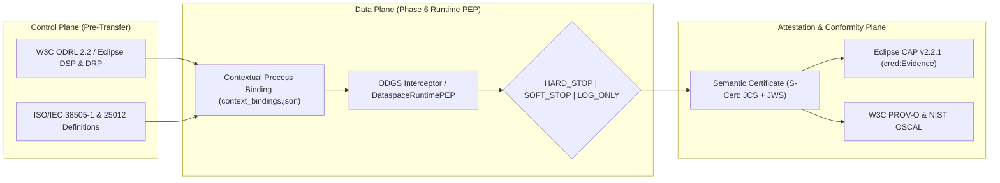

# Open Data Governance Standard (ODGS) — Reference Specification & Runtime Engine (`v6.1.0`)

[](1_NORMATIVE_SPECIFICATION/SPECIFICATION.md)
[](https://metricprovenance.github.io/odgs-protocol/)
[](1_NORMATIVE_SPECIFICATION/SPECIFICATION.md)
[](https://metricprovenance.github.io/odgs-protocol/)
[](https://doi.org/10.5281/zenodo.18564270)
[](LICENSE)

> **Vendor-Neutral Runtime Semantic Policy Enforcement & Cryptographic Attestation (`S-Cert`) for Data Pipelines and Federated Dataspaces.**

---

## 1. Overview & Architectural Scope

The **Open Data Governance Standard (ODGS)** (`v6.1.0`) resolves the **Definition–Execution Gap** (in-pipeline governance) and the **Phase 6 Operationalisation Gap** (post-transfer usage enforcement in federated dataspaces).

While dataspace control planes (**Eclipse DSP/DCP**, **W3C ODRL 2.2**, **Eclipse DRP**, and the **Gaia-X Data Transfer Agent**) govern *pre-transfer negotiation and credential verification*, ODGS governs **in-pipeline runtime execution** once data arrives at the processing boundary — deterministically evaluating payload constraints (`HARD_STOP`, `SOFT_STOP`, `LOG_ONLY`) and emitting a zero-knowledge **Semantic Certificate (`S-Cert`)** (RFC 8785 JCS + RFC 7515 JWS).

### Normative Standards Alignment

| Standard / Ecosystem | Normative Specification | Role in ODGS `v6.1.0` |
| :--- | :--- | :--- |
| **ISO/IEC JTC 1/SC 40** | `ISO/IEC 38505-1:2026` & `TR 38505-2:2018` | Separates corporate governance of data (*Evaluate, Direct, Monitor*) from operational data management via contextual process bindings (`context_bindings.json`). |
| **ISO/IEC JTC 1/SC 7 & TC 184** | `ISO/IEC 25012:2008`, `ISO 8000-8`, `ETSI EN 304 311` | Grounds all 60 data quality dimensions in `standard_dq_dimensions.json` (`Inherent`, `System-Dependent`, `Inherent_and_System_Dependent`). |
| **W3C** | `W3C ODRL 2.2`, `W3C VC 2.0`, `W3C PROV-O`, `W3C OWL 2` | Compiles ODRL 2.2 agreements into executable rules (`odrl_binder.py`) and exports `S-Cert` lineage graphs (`export_w3c_prov_o`). |
| **Eclipse Dataspace Working Group** | `Eclipse CAP v2.2.1` (`LinkML`) & `Eclipse DRP` | Projects runtime `S-Cert` receipts into `cap:Declaration` and `cred:Evidence` Verifiable Credentials (`cap_exporter.py`) and enforces DRP `delegationEvidence`. |
| **Gaia-X & IDSA** | `Gaia-X Architecture 25.11` (§4.8.4.2) & `IDSA Rulebook 2026-3` (§121) | Verifies Phase 6 post-transfer obligations and upstream provenance hashes (`dta_verifier.py`) with decentralized `correlation_id` observability. |
| **NIST** | `NIST OSCAL v1.1.2` | Exports runtime evaluation outcomes as OSCAL Assessment Results `finding` and `observation` records (`export_nist_oscal_finding`). |

---

## 2. Repository Structure

```text
├── 1_NORMATIVE_SPECIFICATION/
│   ├── SPECIFICATION.md                        # Normative 5-Plane & Phase 6 Dataspace Specification
│   ├── conformance_rules.md                    # Level 1 Core & Level 2 Attested Conformance Rules
│   ├── ontology/
│   │   ├── ontology_graph.owl                  # W3C OWL 2 Ontology (ISO/IEC 38505 & 25012 grounded)
│   │   └── odgs_dataspace.linkml.yaml          # LinkML Dataspace Vocabulary (Eclipse CAP / W3C PROV-O mapped)
│   └── schemas/
│       ├── 01-metrics-schema.json              # Plane II: Metric Definitions Schema
│       ├── 02-rules-schema.json                # Plane III: Validation Rules Schema
│       ├── 03-ontology-schema.json             # Plane IV: Contextual Process Bindings Schema
│       ├── 04-s-cert-schema.json               # Plane V: Semantic Certificate (S-Cert) Schema
│       ├── odgs-dataspace.context.jsonld       # JSON-LD Context (odgs, odrl, cred, prov, cap, ovc)
│       ├── legislative/                        # 72 Metrics, 60 ISO/IEC 25012 DQ Dimensions, Ontology Graph
│       ├── judiciary/                          # 101 Validation Rules & Root Cause Taxonomy
│       └── executive/                          # Contextual Process Bindings & Physical Data Maps
├── 2_INFORMATIVE_REFERENCE/
│   ├── architecture/                           # Reference Architecture, Adapter, Ontology & Audit Guides
│   └── src/
│       ├── odgs/
│       │   ├── core/                           # Cryptographic hashing (RFC 8785 JCS) & Adapter ABC
│       │   ├── executive/                      # OdgsInterceptor (Python Runtime PEP)
│       │   ├── dataspace/                      # ODRL 2.2 Binder, Phase 6 PEP, CAP/PROV-O/OSCAL Exporters, DTA Verifier
│       │   └── system/                         # CLI (`odgs`), FastAPI Server, Schema Validators, dbt Adapter
│       └── interceptor.js                      # Cross-language Node.js Interceptor Reference Implementation
├── docs/                                       # MkDocs Technical Documentation (Eclipse EDWG, Gaia-X, IDSA, LinkML)
├── examples/
│   └── run_all_dataspace_scenarios.py          # End-to-end executable demonstration of Scenarios 1–5
└── tests/                                      # Python (pytest) & Node.js (vitest) Conformance & Parity Suites
```

---

## 3. Quick Start

### Installation (Local Development / Reference Verification)

```bash
pip install -e ".[dev]"
```

### 1. Run the End-to-End Dataspace Scenarios (ODRL 2.2 → Phase 6 PEP → S-Cert → CAP v2.2.1 / PROV-O / OSCAL)

```bash
# Run all 5 normative dataspace scenarios (HARD_STOP, SOFT_STOP, LOG_ONLY, DTA Provenance, CAP/PROV-O/OSCAL)
python3 examples/run_all_dataspace_scenarios.py

# Or via the CLI:
odgs dataspace-demo --format cap-vc
odgs dataspace-demo --format s-cert
odgs dataspace-demo --format prov-o
odgs dataspace-demo --format oscal
```

### 2. In-Pipeline Enforcement in Python (`OdgsInterceptor` & `DataspaceRuntimePEP`)

```python
from odgs.dataspace.odrl_binder import bind_odrl_policy
from odgs.dataspace.runtime_pep import DataspaceRuntimePEP, AdministrativeRecusalError
from odgs.dataspace.cap_exporter import export_cap_declaration_vc

odrl_agreement = {
    "@context": "http://www.w3.org/ns/odrl.jsonld",
    "@type": "Agreement",
    "uid": "urn:uuid:agreement-energy-grid-2026-091",
    "obligation": [{
        "uid": "urn:odrl:duty:k-anonymity-min-50",
        "action": "aggregate",
        "constraint": [{
            "leftOperand": "aggregation_household_count",
            "operator": "gteq",
            "rightOperand": 50
        }]
    }]
}

process_urn = "urn:odgs:process:energy-consumer:grid-load-forecasting"
rules, binding = bind_odrl_policy(odrl_agreement, process_urn=process_urn)
pep = DataspaceRuntimePEP(rules=rules, bindings=[binding])

# Evaluate runtime payload and emit Semantic Certificate (S-Cert)
s_cert = pep.evaluate(
    process_urn=process_urn,
    payload={"aggregation_household_count": 64, "region": "NL-ZH"},
)

# Project S-Cert into an Eclipse CAP v2.2.1 Declaration Verifiable Credential
cap_vc = export_cap_declaration_vc(
    s_cert,
    issuer_did="did:web:consumer.energy-dataspace.eu",
    subject_did="did:web:consumer.energy-dataspace.eu#pipeline-1",
)
```

---

## 4. The 5-Plane Architecture & Phase 6 Dataspace Handshake



---

## 5. Verification & Test Suite

```bash
# Run Python test suite (core interceptor, ISO schema conformance, and dataspace bridge)
pytest

# Run cross-language Node.js parity tests
npm test

# Build technical documentation strictly
mkdocs build --strict
```

---

## 6. License

Released under the **Apache License, Version 2.0**. See [LICENSE](LICENSE) and [GOVERNANCE.md](GOVERNANCE.md).