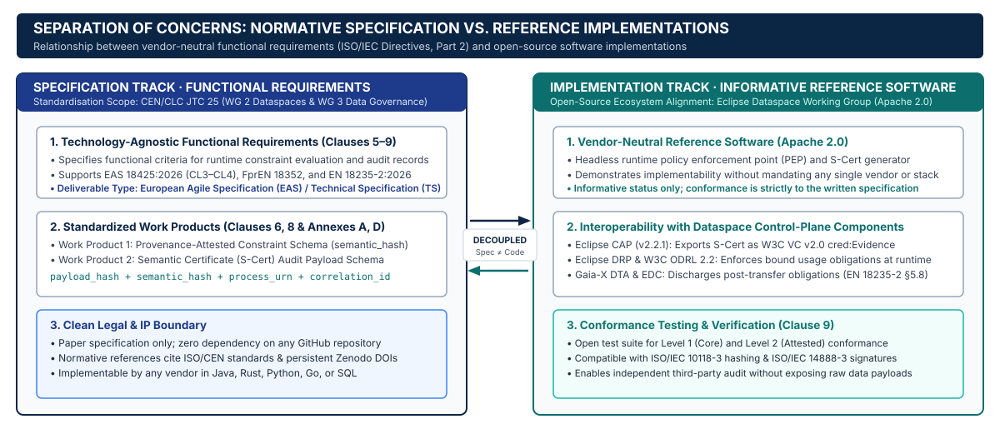
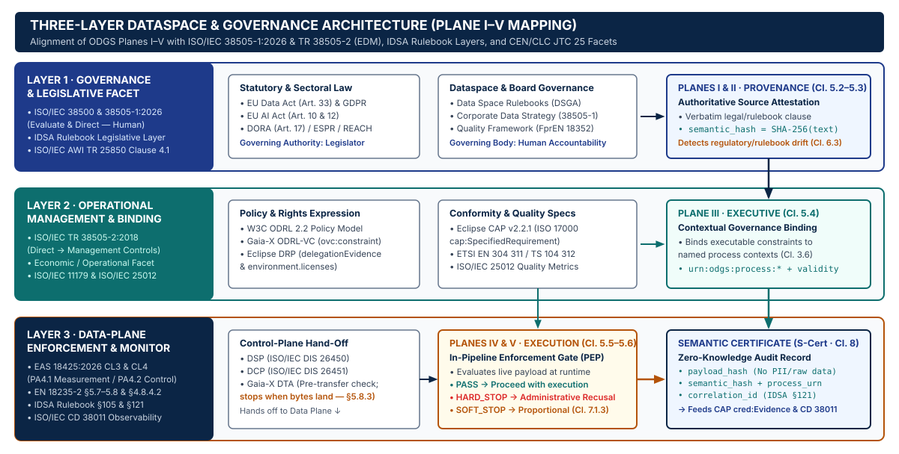
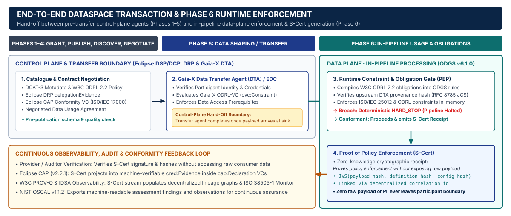

# 5-Plane Architecture & Standards Alignment (`v6.1.0`)

The **Open Data Governance Standard (ODGS)** (`v6.1.0`) specifies a deterministic architecture that separates declarative governance definitions from physical execution pipelines, closing both the **Definition–Execution Gap** inside enterprises and the **Phase 6 Operationalisation Gap** across federated dataspaces.

---

## 1. Two Complementary Governance Tracks

Data governance across modern data ecosystems operates along two complementary tracks:

1. **Pre-Transfer Control Plane** (`Eclipse DSP/DCP`, `W3C ODRL 2.2`, `Eclipse DRP`, `Gaia-X Data Transfer Agent`) — governs participant identity, catalog discovery, contract negotiation, and transfer authorization *before* data crosses an organizational boundary.
2. **In-Pipeline Runtime Enforcement Plane (`ODGS v6.1.0`)** — governs deterministic payload evaluation (`HARD_STOP`, `SOFT_STOP`, `LOG_ONLY`) and cryptographic attestation (`S-Cert`) *at the moment data is processed or consumed*.

---

## 2. Three-Layer / Five-Plane Architecture

ODGS structures governance into **Five Normative Planes** grouped across three architectural layers grounded in **`ISO/IEC 38505-1:2026`** (*Evaluate — Direct — Monitor*) and **`ISO/IEC 25012:2008`** (*Data Quality Model*):

| Layer | ODGS Plane | Artifact / Schema | Normative Grounding |
| :--- | :--- | :--- | :--- |
| **Layer 1: Declarative Definition (`Direct`)** | **Plane I — Regulatory & Contractual Baseline** | `W3C ODRL 2.2` agreements, statutory/sector packs | `W3C ODRL 2.2`, `EU AI Act Art. 10 & 12` |
| **Layer 1: Declarative Definition (`Direct`)** | **Plane II — Semantic Metric & DQ Registry** | `01-metrics-schema.json`, `standard_dq_dimensions.json`, `ontology_graph.owl` | `ISO/IEC 25012:2008`, `ISO 8000-8`, `W3C OWL 2` |
| **Layer 1: Declarative Definition (`Direct`)** | **Plane III — Deterministic Validation Logic** | `02-rules-schema.json`, `standard_validation_rules.json` | Boolean / AST rule expressions, severity classification |
| **Layer 2: Contextual Binding (`Evaluate & Direct`)** | **Plane IV — Contextual Process Binding** | `03-ontology-schema.json`, `context_bindings.json` | `ISO/IEC 38505-1:2026` & `TR 38505-2:2018` |
| **Layer 3: Runtime Enforcement (`Monitor`)** | **Plane V — Runtime PEP & Semantic Certificate (`S-Cert`)** | `04-s-cert-schema.json`, `OdgsInterceptor`, `DataspaceRuntimePEP` | `RFC 8785 (JCS)`, `RFC 7515 (JWS)`, `Eclipse CAP v2.2.1`, `W3C PROV-O`, `NIST OSCAL v1.1.2` |

---

## 3. Trustworthy Data Transaction (`TDT`) Sequence

In a federated dataspace transaction aligned with **`EN 18235`** (*Trustworthy Data Transactions*) and **`EAS 18425:2026`** (*European Dataspace Interoperability Specification*), ODGS operates as the Phase 6 Runtime Policy Enforcement Point (`PEP`) at the processing boundary:

### Step-by-Step Handshake

1. **Contract & Transfer Authorization (Phases 1–5):** The Provider and Consumer negotiate a `W3C ODRL 2.2` Agreement (`odrl:Agreement`) and execute data transfer with an upstream provenance digest (`dta_provenance_hash`).
2. **ODRL-to-ODGS Compilation (`odrl_binder.py`):** The Consumer's boundary compiles `odrl:obligation` and `odrl:prohibition` constraints into deterministic Plane III rules and a Plane IV contextual binding (`context_bindings.json`).
3. **Runtime Interception (`DataspaceRuntimePEP`):** Before the target pipeline (`process_urn`) executes, the PEP verifies upstream provenance (`dta_verifier.py`) and evaluates every bound constraint against the runtime payload or batch metadata.
4. **Deterministic Enforcement:**
   - `HARD_STOP`: Raises `AdministrativeRecusalError` / `ProcessBlockedException` and halts execution prior to sink commit.
   - `SOFT_STOP`: Halts execution unless a cryptographic `override_token` is supplied and logged in the attestation.
   - `LOG_ONLY`: Permits execution while recording the warning outcome in the audit trail.
5. **Zero-Knowledge Attestation (`S-Cert`):** Emits an RFC 8785 JCS canonicalized receipt binding `payload_hash`, `definition_hash`, and `config_hash` without exposing raw payload records.
6. **Multi-Format Conformity Projection:** Exports the `S-Cert` into **Eclipse CAP v2.2.1** (`cap:Declaration` / `cred:Evidence`), **W3C PROV-O** (`prov:Activity`), and **NIST OSCAL v1.1.2** (`finding` / `observation`).
