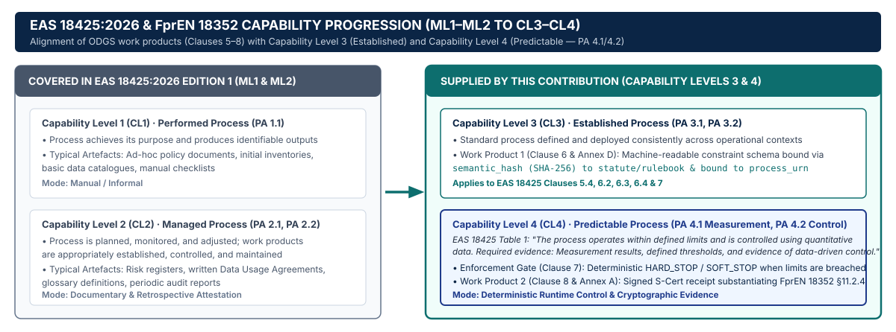

# Conformance Levels & Interoperability Profiles (`v6.1.0`)

This page documents the normative requirements for achieving **ODGS Implementation Conformance** (`Level 1 Core` and `Level 2 Attested`) and disambiguates them from European dataspace interoperability profiles (`EAS 18425:2026`) and conformity assessment vocabularies (`ISO/IEC 17000` / `Eclipse CAP v2.2.1`).

---

## 1. Terminology Disambiguation

| Framework | Scope | Levels / Artifacts |
| :--- | :--- | :--- |
| **ODGS Implementation Conformance** | Applies strictly to software implementations of the ODGS specification (`1_NORMATIVE_SPECIFICATION/conformance_rules.md`). | `Level 1 Core` (`L1`), `Level 2 Attested` (`L2`) |
| **EAS 18425:2026 Dataspace Profiles** | European Dataspace Interoperability Specification capability levels across federated ecosystems. | `CL0` through `CL5` (ODGS provides the runtime verification mechanism for `CL3`–`CL5`) |
| **ISO/IEC 17000 & Eclipse CAP v2.2.1** | Formal conformity assessment vocabularies into which ODGS projects cryptographic runtime evidence. | `cap:ConformityAssessmentScheme`, `cap:Declaration`, `cred:Evidence` |

---

## 2. ODGS Implementation Conformance Levels (`L1` & `L2`)

The key words `MUST`, `MUST NOT`, `REQUIRED`, `SHALL`, `SHALL NOT`, `SHOULD`, and `MAY` follow **RFC 2119**.

| Level | Designation | Normative Requirements | Verification Command |
| :--- | :--- | :--- | :--- |
| **L1** | **Level 1 Core** | Planes II–IV JSON artifacts exist and validate against Draft-07 JSON Schemas (`01-metrics-schema.json`, `02-rules-schema.json`, `03-ontology-schema.json`), with data quality dimensions grounded in `ISO/IEC 25012:2008`. | `odgs conformance --level L1` |
| **L2** | **Level 2 Attested** | Satisfies `L1` plus full cross-reference integrity across `context_bindings.json`, deterministic `HARD_STOP`/`SOFT_STOP`/`LOG_ONLY` enforcement, RFC 8785 (JCS) canonical hashing, and `04-s-cert-schema.json` attestation emission. | `odgs conformance --level L2` |

### Core Conformance Clauses

1. **Semantic & Contextual Decoupling (`ISO/IEC 38505-1:2026`):** Policy definitions (Planes I–III) SHALL be strictly decoupled from contextual process bindings (Plane IV) and physical execution (Plane V). Hard-coding legal, contractual, or data quality definitions inside application execution logic constitutes non-conformance.
2. **Ontology & Data Quality Baseline (`ISO/IEC 25012:2008`):** Governance artifacts MUST validate against the normative JSON Schemas and the W3C OWL 2 / LinkML ontologies (`ontology_graph.owl`, `odgs_dataspace.linkml.yaml`).
3. **Deterministic Enforcement (`HARD_STOP`, `SOFT_STOP`, `LOG_ONLY`):**
   - When a `HARD_STOP` rule fails, the PEP SHALL halt execution (`ProcessBlockedException` / `AdministrativeRecusalError`) and MUST NOT probabilistically impute or bypass the failed constraint.
   - When a `SOFT_STOP` rule fails, the engine SHALL halt execution unless a valid `override_token` is supplied, and MUST record the SHA-256 digest of the override token in the resulting attestation.
4. **Cryptographic Attestation (`S-Cert` — Zero-Knowledge Auditing):** Upon completing an evaluation (`APPROVED`, `SOFT_STOP_OVERRIDDEN`, or `BLOCKED_HARD_STOP`), a Level 2 conformant implementation MUST emit a canonical **Semantic Certificate (`S-Cert`)** binding `payload_hash`, `definition_hash`, and `config_hash` via RFC 8785 (JCS) without transmitting raw data payloads to external third-party servers.

---

## 3. Alignment with `EAS 18425:2026` Conformance Profiles (`CL0–CL5`)

Within European dataspace architectures, `EAS 18425:2026` defines progressive capability levels (`CL0–CL5`). While pre-transfer connectors address `CL0–CL2` (cataloging, identity, and contract negotiation), ODGS provides the normative in-pipeline runtime enforcement and cryptographic evidence required for **`CL3` (Semantic & Schema Conformance)**, **`CL4` (Automated Policy & Obligation Enforcement)**, and **`CL5` (Cryptographic Auditability & Continuous Conformity Assessment)**:

