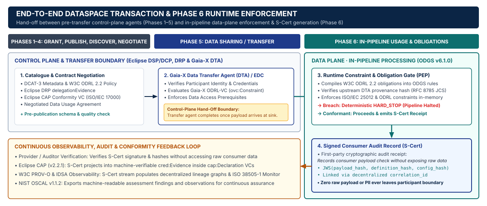

# Eclipse Dataspace Working Group (EDWG) Integration (`Data Plane Signaling`, `DSP`, `DCP`, `CAP v2.2.1`, `DRP`)

**ODGS (`v6.1.0`)** integrates as a **consumer-side data-plane constraint evaluator and first-party cryptographic audit recorder** alongside connectors implementing the **Eclipse Dataspace Working Group (EDWG)** specifications:

1. **Data Plane Signaling** — Runs as (or behind) a consumer data plane registered with the consumer control plane (`DataPlaneSignalingBridge`), handling `DataFlowPrepareMessage` / `DataFlowStartMessage` (`processId` / `dataFlowId` + `agreementId`) and retrieving the negotiated agreement via `GET /transfers/:dataFlowId/agreement`.
2. **Eclipse Dataspace Protocol (`DSP v2025-1` / `ISO/IEC DIS 26450`)** — Drives evaluation from the negotiated `odrl:Agreement`, binds `agreementId` and transfer process ID into the `S-Cert` `correlation_id`, and emits `dspace:TransferSuspensionMessage` (`SOFT_STOP`) or `dspace:TransferTerminationMessage` (`HARD_STOP`) on violation so the consumer control plane can notify the provider.
3. **Eclipse Decentralized Claims Protocol (`DCP v1.0` / `ISO/IEC DIS 26451`)** — Issues runtime audit evidence as a W3C Verifiable Credential (`cap:Declaration`) signed with a key from the consumer's `did:web` document, held in the consumer's `CredentialService`, and presented to a provider via `PresentationQueryMessage` → `PresentationResponseMessage` (`handle_dcp_presentation_query`) as a policy condition for subsequent negotiations or transfers.
4. **Eclipse Conformity Assessment Policy (`CAP v2.2.1`)** — Projects `S-Cert` audit receipts into `cap:Declaration` (ISO/IEC 17000 first-party self-declaration) and `cred:Evidence` (`export_cap_declaration_vc`, `export_cap_cred_evidence`).
5. **Eclipse Dataspace Rights Profile (`DRP`)** — Evaluates payload-observable `delegationEvidence` license and resource constraints (`bind_drp_delegation_evidence`).

> **Scope Boundary (Integration vs. Re-Implementation):** ODGS does **not** re-implement control-plane contract negotiation, credential transport, or signaling state machines; instead, it integrates with a compliant consumer control plane (such as Eclipse EDC) at the control-to-data-plane boundary.

---

## 1. Trust Model & Constraint Observability Boundary

To ensure architectural precision in cross-organizational dataspace deployments, ODGS states its trust assumptions and observability boundaries explicitly:

1. **Consumer-Signed First-Party Audit Record (`CONSUMER_FIRST_PARTY_AUDIT_RECORD`):**
   - `S-Cert` receipts are generated and signed **by the consumer** within its own processing pipeline over payload values supplied by the consumer.
   - Accordingly, an `S-Cert` (and its projected `cap:Declaration` Verifiable Credential under ISO/IEC 17000) records that **the consumer attests to having executed a deterministic check** over a specific payload digest (`payload_hash`) and rule digest (`semantic_hash`) under `agreementId`. It serves as a tamper-evident **audit record**, **not** provider-verified proof of policy enforcement.
2. **Payload-Observable Constraints vs. Unobservable Usage Obligations (`inspect_odrl_constraint_observability`):**
   - **Observable in-payload prior to processing:** Structural, schema, value-range, and aggregation constraints over payload fields (e.g., `aggregation_household_count >= 50`, value bounds, or schema completeness).
   - **Not observable by pre-processing payload inspection:** Behavioral constraints on downstream use — such as **`purpose`** (`odrl:purpose`), **`retention`** (`odrl:elapsedTime` / `odrl:dateTime`), or **`onward sharing`** (`odrl:distribute` / `odrl:share`).
   - `inspect_odrl_constraint_observability()` explicitly classifies every ODRL policy into `observable_payload_operands` and `unobservable_usage_constraints` so neither consumers nor providers mistake pre-processing payload checks for verification of downstream behavioral usage.

---

## 2. Data Plane Signaling & DSP Transfer Lifecycle (`odgs.dataspace.signaling`)

When deployed as (or behind) a consumer data plane registered with a consumer control plane:

1. **Flow Preparation (`DataFlowPrepareMessage` / `DataFlowStartMessage`):** The consumer control plane sends a prepare/start signaling message containing `agreementId` and `processId` / `dataFlowId` (equal to the DSP transfer process ID).
2. **Agreement Retrieval (`GET /transfers/:dataFlowId/agreement`):** `DataPlaneSignalingBridge` calls the control plane's agreement retrieval endpoint (`build_agreement_retrieval_path(data_flow_id)`) via `AgreementResolver` to fetch the negotiated `odrl:Agreement` and classify constraint observability.
3. **Violation Signaling (`TransferSuspensionMessage` / `TransferTerminationMessage`):** If an observable payload constraint fails during `evaluate_flow()`, the bridge produces a `dspace:TransferTerminationMessage` (`HARD_STOP`) or `dspace:TransferSuspensionMessage` (`SOFT_STOP`) referencing the `dataFlowId` (`dspace:consumerPid`), `dspace:providerPid`, and `S-Cert` digest so the consumer control plane can suspend or terminate the transfer with the provider.

```python
from odgs.dataspace import (
    DataPlaneSignalingBridge,
    build_agreement_retrieval_path,
)

# Consumer data plane resolves GET /transfers/:dataFlowId/agreement on the consumer control plane
bridge = DataPlaneSignalingBridge(
    agreement_resolver=control_plane_client,
    control_plane_notifier=control_plane_client,
    system_id="consumer-dataplane-01",
)

# 1. Control plane sends DataFlowPrepareMessage (dataFlowId == DSP transfer process ID)
response = bridge.prepare_flow(
    signaling_message={
        "@context": "https://w3id.org/dspace/2025/1/dps/context.jsonld",
        "@type": "DataFlowPrepareMessage",
        "processId": "urn:uuid:dsp-transfer-flow-7701",
        "agreementId": "urn:uuid:dsp-agreement-grid-2026-44",
        "providerPid": "urn:uuid:provider-transfer-pid-88",
    },
    process_urn="urn:odgs:process:consumer:dataplane-ingest",
)

# 2. Evaluate incoming flow payload; on HARD_STOP emits dspace:TransferTerminationMessage
result = bridge.evaluate_flow(
    data_flow_id="urn:uuid:dsp-transfer-flow-7701",
    payload={"aggregation_household_count": 82, "region": "NL-ZH"},
)
# result.trust_model == "CONSUMER_FIRST_PARTY_AUDIT_RECORD"
# result.s_cert.correlation_id == "urn:uuid:dsp-agreement-grid-2026-44#transfer:urn:uuid:dsp-transfer-flow-7701"
```

---

## 3. Direct Eclipse DSP Binding (`DSP v2025-1` / `ISO/IEC DIS 26450`)

| Eclipse DSP Message / Construct (`https://w3id.org/dspace/2025/1/context.jsonld`) | Control-Plane Role in DSP (`ISO/IEC DIS 26450`) | Data-Plane Role in ODGS (`odgs.dataspace`) |
| :--- | :--- | :--- |
| **`dspace:ContractAgreementMessage` & `GET /transfers/:dataFlowId/agreement`** | Finalizes and exposes the negotiated `odrl:Agreement` between `dspace:providerId` and `dspace:consumerId`. | Ingested by `DataPlaneSignalingBridge` / `bind_dsp_contract_agreement()` to compile payload-observable constraints and classify unobservable usage terms. |
| **`dspace:TransferStartMessage`** | Signals transfer execution via `dspace:consumerPid`, `dspace:providerPid`, and `dspace:agreementId`. | Verifies `dspace:agreementId` continuity and binds `correlation_id = "<agreementId>#transfer:<consumerPid>"` into emitted `S-Cert` audit records. |
| **`dspace:TransferSuspensionMessage` / `dspace:TransferTerminationMessage`** | Notifies the provider when a consumer control plane suspends or terminates a transfer process. | Emitted by `build_dsp_transfer_suspension_message()` (`SOFT_STOP`) and `build_dsp_transfer_termination_message()` (`HARD_STOP`) with `S-Cert` event and digest references. |

---

## 4. Eclipse DCP Credential Issuance & Presentation (`DCP v1.0` / `ISO/IEC DIS 26451`)

Under **Eclipse DCP**, runtime audit records can be issued as **W3C Verifiable Credentials (`cap:Declaration`)** signed directly with a key from the consumer's `did:web` document, stored in the consumer's `CredentialService`, and presented to a provider via a DCP `PresentationQueryMessage` → `PresentationResponseMessage` flow. A provider can require this audit credential in policy as a condition for subsequent contract negotiations or transfers:

```python
from cryptography.hazmat.primitives.asymmetric.ed25519 import Ed25519PrivateKey
from odgs.dataspace import (
    export_cap_declaration_vc,
    handle_dcp_presentation_query,
    sign_s_cert_ed25519,
    verify_cap_declaration_vc,
)

consumer_did = "did:web:consumer.energy-dataspace.eu"
did_key_id = f"{consumer_did}#key-ed25519-1"
priv_key = Ed25519PrivateKey.generate()

# 1. Sign S-Cert and issue a DID-signed cap:Declaration Verifiable Credential
s_cert_l2 = sign_s_cert_ed25519(
    s_cert=result.s_cert,
    private_key=priv_key,
    authority_id=consumer_did,
    issuing_jwk_url="https://consumer.energy-dataspace.eu/.well-known/jwks.json",
    kid=did_key_id,
)
signed_vc = export_cap_declaration_vc(
    s_cert=s_cert_l2,
    issuer_did=consumer_did,
    subject_did=f"{consumer_did}#dataplane-01",
    private_key=priv_key,
    verification_method=did_key_id,
)

# 2. Respond to Provider's DCP PresentationQueryMessage from Consumer CredentialService
dcp_response = handle_dcp_presentation_query(
    query_message={
        "@context": ["https://w3id.org/dspace-dcp/v1.0/dcp.jsonld"],
        "type": "PresentationQueryMessage",
        "scope": ["org.eclipse.dspace.dcp.vc.type:cap:Declaration:read"],
    },
    stored_credentials=[signed_vc],
    holder_did=consumer_did,
    private_key=priv_key,
    verification_method=did_key_id,
)

# 3. Provider verifies the consumer's DID-signed VC signature and issuer DID
is_valid = verify_cap_declaration_vc(
    vc=dcp_response["presentation"][0]["verifiableCredential"][0],
    public_key=priv_key.public_key(),
    expected_issuer_did=consumer_did,
)
```

---

## 5. Complementarity with Eclipse CAP (`v2.2.1`) & Eclipse DRP

- **Eclipse CAP v2.2.1 (`LinkML` Ontology):** Formalizes ISO/IEC 17000 conformity-assessment classes (`cap:Declaration` first-party self-assessment, `cap:Certification` third-party assessment, `cred:Evidence`). Because an `S-Cert` is signed by the consumer over its own pipeline execution, ODGS maps it strictly to **`cap:Declaration`** (first-party consumer declaration) with `cred:Evidence` (`sha256-<RFC 8785 JCS digest>`).
- **Eclipse DRP (`delegationEvidence`):** Defines `policyIssuer`, `target.accessSubject`, `target.environment.licenses`, and `Permit`/`Deny` rules. `bind_drp_delegation_evidence()` compiles payload-observable license/attribute checks into `HARD_STOP` rules and emits a consumer-signed `S-Cert` audit record of the check.

---

## 6. End-to-End EDWG Architecture Flow (`Signaling` + `DSP` + `DCP` + `CAP` + `DRP`)



| Step | Protocol / Boundary | Message / Endpoint / Function | Description |
| :--- | :--- | :--- | :--- |
| **1** | **Eclipse DSP (`ISO/IEC DIS 26450`)** | `dspace:ContractAgreementMessage` | Provider and Consumer finalize the contract (`odrl:Agreement` `@id`). |
| **2** | **Data Plane Signaling** | `DataFlowPrepareMessage` / `DataFlowStartMessage` | Consumer control plane signals consumer data plane with `agreementId` and `processId` (`dataFlowId`). |
| **3** | **Control-to-Data Agreement Fetch** | `GET /transfers/:dataFlowId/agreement` | `DataPlaneSignalingBridge.prepare_flow()` retrieves the DSP agreement, classifies constraint observability, and compiles payload-observable checks. |
| **4** | **ODGS Data-Plane PEP** | `DataPlaneSignalingBridge.evaluate_flow()` | Evaluates observable payload fields (`PASS` \| `HARD_STOP` \| `SOFT_STOP` \| `LOG_ONLY`) and emits a consumer-signed `S-Cert` audit record. |
| **5** | **Eclipse DSP Violation Callback** | `dspace:TransferSuspensionMessage` / `TransferTerminationMessage` | On `SOFT_STOP` or `HARD_STOP`, notifies the consumer control plane to suspend or terminate the DSP transfer with the provider. |
| **6** | **Eclipse DCP + CAP (`v2.2.1`)** | `PresentationQueryMessage` → `PresentationResponseMessage` | Consumer issues a DID-signed `cap:Declaration` VC into its `CredentialService` and presents it via DCP when queried by the provider. |
