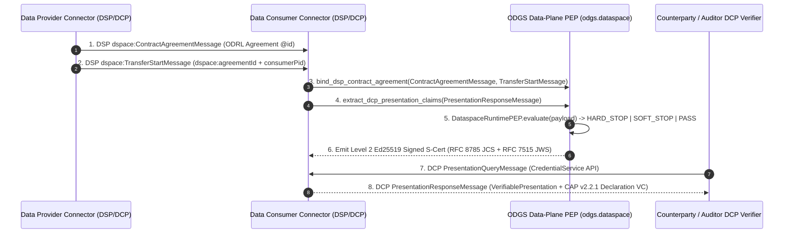

# Eclipse Dataspace Working Group (EDWG) Interoperability (`DSP`, `DCP`, `CAP v2.2.1`, `DRP`)

**ODGS (`v6.1.0`)** operates as the **Data-Plane Runtime Policy Enforcement Point (`PEP`) and Cryptographic Evidence Engine** for connectors implementing the **Eclipse Dataspace Working Group (EDWG)** protocol suite:

1. **Eclipse Dataspace Protocol (`DSP v2025-1` / `ISO/IEC DIS 26450`)** — Control-Plane Contract Negotiation & Transfer Process binding (`bind_dsp_contract_agreement`).
2. **Eclipse Decentralized Claims Protocol (`DCP v1.0` / `ISO/IEC DIS 26451`)** — Verifiable Presentation & `CredentialService` exchange (`export_dcp_presentation_response`, `extract_dcp_presentation_claims`).
3. **Eclipse Conformity Assessment Policy (`CAP v2.2.1`)** — Automated conformity declaration and `cred:Evidence` projection (`export_cap_declaration_vc`, `export_cap_cred_evidence`).
4. **Eclipse Dataspace Rights Profile (`DRP`)** — Runtime enforcement of `delegationEvidence` license and target environment constraints (`bind_drp_delegation_evidence`).

---

## 1. Interoperability with Eclipse Dataspace Protocol (`DSP v2025-1` / `ISO/IEC DIS 26450`)

In the **Eclipse Dataspace Protocol (`DSP`)**, control-plane negotiation and transfer coordination occur across two state machines: the **Contract Negotiation Protocol** (`AGREED` $\rightarrow$ `VERIFIED` $\rightarrow$ `FINALIZED`) and the **Transfer Process Protocol** (`STARTED` $\rightarrow$ `COMPLETED`). However, DSP explicitly delegates **data-plane payload enforcement and post-transfer obligation verification** to the participating runtime environment.

ODGS binds directly to DSP control-plane messages via `bind_dsp_contract_agreement()`:

| Eclipse DSP Message / Construct (`https://w3id.org/dspace/2025/1/context.jsonld`) | Control-Plane Role in DSP (`ISO/IEC DIS 26450`) | Data-Plane Role in ODGS (`odgs.dataspace`) |
| :--- | :--- | :--- |
| **`dspace:ContractAgreementMessage`** | Finalizes the negotiated contract between `dspace:providerId` and `dspace:consumerId`. | Ingested by `bind_dsp_contract_agreement()` to extract the agreement `@id` and compile the embedded `dspace:agreement` into deterministic AST rules. |
| **`dspace:agreement` (`odrl:Agreement`)** | Contains `odrl:permission`, `odrl:prohibition`, and `odrl:obligation` (`odrl:duty`) rules over `odrl:target`. | Compiled into `ExecutableRule` objects with SHA-256 `semantic_hash` digests over the canonical ODRL rule clauses. |
| **`dspace:TransferStartMessage` / `dspace:TransferCompletionMessage`** | Signals data-plane transfer execution via `dspace:consumerPid`, `dspace:providerPid`, and `dspace:agreementId`. | Verifies that `dspace:agreementId` matches the negotiated `dspace:agreement["@id"]` (rejecting spoofed or mismatched transfers) and binds `correlation_id = "<agreementId>#transfer:<consumerPid>"`. |
| **Data-Plane Payload Execution** | Out of scope for the DSP control plane once bytes arrive at the `dspace:dataAddress` endpoint. | `DataspaceRuntimePEP.evaluate()` intercepts the payload in-memory, enforces `HARD_STOP` / `SOFT_STOP` / `LOG_ONLY`, and emits a signed **`S-Cert`** bound to the DSP `correlation_id`. |

### Executable DSP Integration Example

```python
from odgs.dataspace import (
    DataspaceRuntimePEP,
    bind_dsp_contract_agreement,
)

# 1. DSP Control-Plane ContractAgreementMessage (ISO/IEC DIS 26450)
dsp_contract_agreement_msg = {
    "@context": "https://w3id.org/dspace/2025/1/context.jsonld",
    "@type": "dspace:ContractAgreementMessage",
    "dspace:providerPid": "urn:uuid:dsp-provider-pid-101",
    "dspace:consumerPid": "urn:uuid:dsp-consumer-pid-202",
    "dspace:agreement": {
        "@id": "urn:uuid:dsp-agreement-energy-2026-901",
        "@type": "odrl:Agreement",
        "odrl:target": "urn:uuid:dataset-smart-grid-2026",
        "dspace:timestamp": "2026-11-05T12:00:00Z",
        "dspace:consumerId": "did:web:consumer.energy-dataspace.eu",
        "dspace:providerId": "did:web:provider.energy-dataspace.eu",
        "odrl:obligation": [
            {
                "odrl:uid": "urn:odrl:duty:k-anonymity-min-50",
                "odrl:action": "odrl:aggregate",
                "odrl:constraint": [
                    {
                        "odrl:leftOperand": "aggregation_household_count",
                        "odrl:operator": "odrl:gteq",
                        "odrl:rightOperand": 50,
                    }
                ],
            }
        ],
    },
}

# 2. DSP Control-Plane TransferStartMessage
dsp_transfer_start_msg = {
    "@context": "https://w3id.org/dspace/2025/1/context.jsonld",
    "@type": "dspace:TransferStartMessage",
    "dspace:providerPid": "urn:uuid:transfer-provider-501",
    "dspace:consumerPid": "urn:uuid:transfer-consumer-602",
    "dspace:agreementId": "urn:uuid:dsp-agreement-energy-2026-901",
}

# 3. Compile DSP Agreement + Transfer Process into Data-Plane Runtime PEP
process_urn = "urn:odgs:process:dsp-consumer:grid-load-ingestion"
rules, binding = bind_dsp_contract_agreement(
    dsp_agreement_message=dsp_contract_agreement_msg,
    process_urn=process_urn,
    transfer_message=dsp_transfer_start_msg,
)

pep = DataspaceRuntimePEP(rules=rules, bindings=[binding])
s_cert = pep.evaluate(
    process_urn=process_urn,
    payload={"aggregation_household_count": 75, "region": "NL-ZH"},
)
# s_cert.correlation_id == "urn:uuid:dsp-agreement-energy-2026-901#transfer:urn:uuid:transfer-consumer-602"
```

---

## 2. Interoperability with Eclipse Decentralized Claims Protocol (`DCP v1.0` / `ISO/IEC DIS 26451`)

The **Eclipse Decentralized Claims Protocol (`DCP`)** defines how Dataspace participants authenticate via **`did:web`** / Self-Issued ID Tokens (`SIOPv2`) and exchange **W3C Verifiable Presentations (`VerifiablePresentation`)** via the **`CredentialService` API** (`PresentationQueryMessage` $\rightarrow$ `PresentationResponseMessage`).

ODGS interoperates with **Eclipse DCP** in both directions:

| Direction | Eclipse DCP Construct (`https://w3id.org/dspace-dcp/v1.0/dcp.jsonld`) | ODGS Function & Mechanism |
| :--- | :--- | :--- |
| **Inbound (DCP $\rightarrow$ ODGS Runtime Context)** | `PresentationResponseMessage` carrying participant `VerifiablePresentation` / `VerifiableCredential` claims verified against the holder's `did:web` JWKS. | `extract_dcp_presentation_claims()` validates the DCP message type and expected `holder` DID (`did:web:...`) and extracts verified credential claims into the ODGS runtime evaluation context. |
| **Outbound (ODGS `S-Cert` $\rightarrow$ DCP `CredentialService`)** | `PresentationResponseMessage` served in response to a counterparty or auditor `PresentationQueryMessage`. | `export_dcp_presentation_response()` wraps the Level 2 Ed25519/JWS-signed `S-Cert` and its `VerifiableCredential` (`cap:Declaration` + `cred:Evidence`) inside a DCP-compliant `PresentationResponseMessage` with `JsonWebSignature2020` proof linked to `issuing_jwk_url` (`did:web` JWKS). |

### Executable DCP Integration Example

```python
from cryptography.hazmat.primitives.asymmetric.ed25519 import Ed25519PrivateKey
from odgs.dataspace import (
    export_dcp_presentation_response,
    extract_dcp_presentation_claims,
    sign_s_cert_ed25519,
)

# 1. Sign the S-Cert with the participant's Ed25519 key (published via did:web JWKS)
priv_key = Ed25519PrivateKey.generate()
s_cert_l2 = sign_s_cert_ed25519(
    s_cert=s_cert,
    private_key=priv_key,
    authority_id="did:web:consumer.energy-dataspace.eu",
    issuing_jwk_url="https://consumer.energy-dataspace.eu/.well-known/jwks.json",
)

# 2. Export as an Eclipse DCP v1.0 PresentationResponseMessage
dcp_response = export_dcp_presentation_response(
    s_cert=s_cert_l2,
    holder_did="did:web:consumer.energy-dataspace.eu",
)

# 3. Verify and extract claims on the Counterparty / Verifier side
verified_claims = extract_dcp_presentation_claims(
    dcp_presentation_message=dcp_response,
    expected_holder_did="did:web:consumer.energy-dataspace.eu",
)
```

---

## 3. Complementarity with Eclipse Conformity Assessment Policy (`CAP v2.2.1`)

- **Eclipse CAP v2.2.1 (`LinkML` Ontology)** defines the Verifiable Credential envelope (`cap:Declaration`, `cap:ConformityAssessment`, `cap:SpecifiedRequirement`, `cred:Evidence`).
- **ODGS** provides the **automated runtime execution engine (`DataspaceRuntimePEP`)** that evaluates data-plane payloads and populates `cred:Evidence` (`export_cap_cred_evidence` & `export_cap_declaration_vc`) with a canonical `sha256-<digest>` and Ed25519 JWS signature.

| Eclipse CAP v2.2.1 Class / Slot | ODGS Runtime Artifact Mapping |
| :--- | :--- |
| `cap:Declaration` (`VerifiableCredential`) | Output of `export_cap_declaration_vc(s_cert, issuer_did, subject_did)` |
| `cap:assessedRequirement` (`cap:SpecifiedRequirement`) | Bound to `urn:odgs:rule:<rule_id>#sha256:<semantic_hash>` |
| `cap:assessmentOutcome` | `"CONFORMANT"` (`Verdict.PASS`) or `"NON_CONFORMANT"` (`HARD_STOP` / `SOFT_STOP`) |
| `cred:Evidence` (`cred:digest`) | Output of `export_cap_cred_evidence(s_cert)` (`sha256-<RFC 8785 JCS digest>`) |

---

## 4. Complementarity with Eclipse Dataspace Rights Profile (`DRP`)

- **Eclipse DRP** defines `delegationEvidence` policies (`policyIssuer`, `target.accessSubject`, `target.environment.licenses`, and `Permit`/`Deny` rules) and includes a mandatory breach clause: if policy conditions are violated, the `accessSubject` **MUST NOT** process the resource.
- **ODGS (`bind_drp_delegation_evidence`)** compiles DRP `delegationEvidence` into a deterministic runtime gate (`HARD_STOP`) that halts execution and emits a signed `S-Cert` proving the breach was prevented before downstream consumption.

---

## 5. End-to-End EDWG Architecture Flow (`DSP` + `DCP` + `DRP` + `CAP`)


